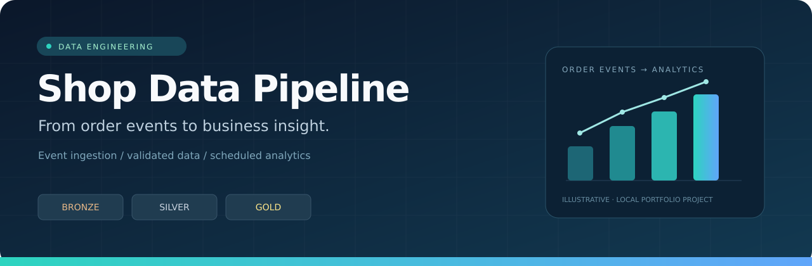
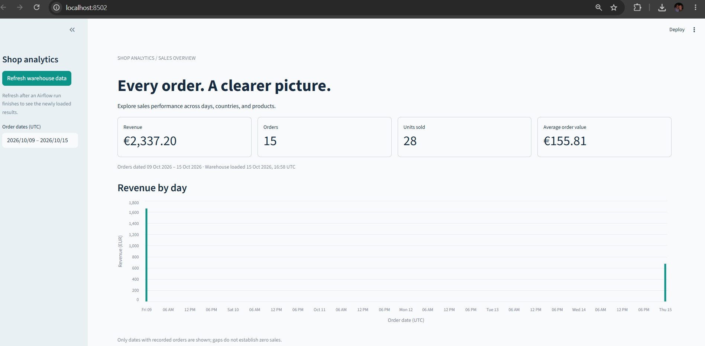
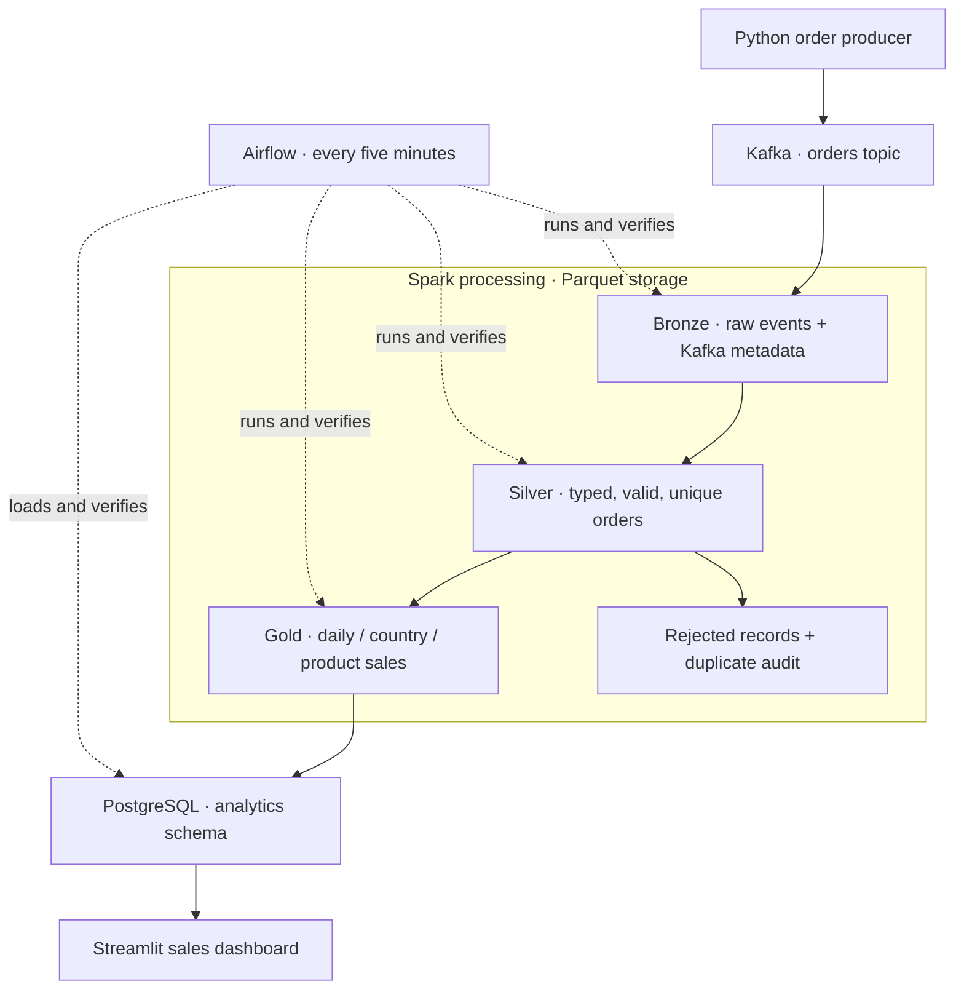
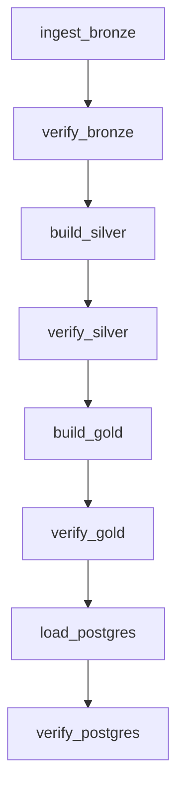
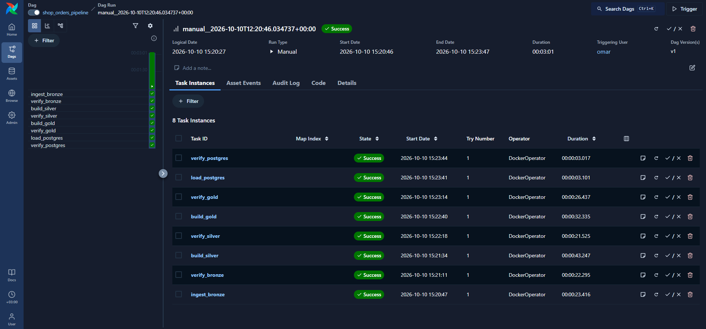
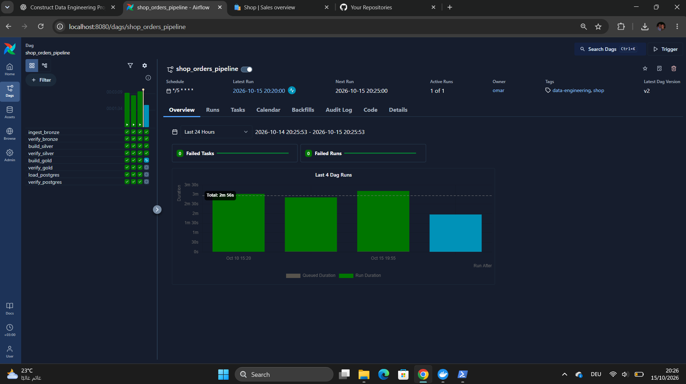

<p align="center">
  
</p>

<p align="center">
  
  
  
  
  <br>
  
  
  
  
</p>

<p align="center"><strong>Capture events. Validate orders. Publish trustworthy sales metrics.</strong></p>
<p align="center">A local, end-to-end data engineering project by Omar Hegab.</p>
<p align="center"><a href="#the-dashboard">Dashboard</a> · <a href="#architecture">Architecture</a> · <a href="#airflow-dag">Airflow DAG</a> · <a href="docs/SETUP.md">Run locally</a> · <a href="docs/VALIDATION.md">Validation</a></p>

## The project

This project turns simulated shop orders into queryable, visual sales analytics.
Python publishes order events to Kafka. Spark preserves raw events in Bronze,
validates and deduplicates them in Silver, and creates business aggregates in Gold.
An atomic PostgreSQL load makes those aggregates available to a Streamlit dashboard.
Airflow coordinates the processing and checks on a five-minute schedule.

The focus is **traceable data, correct totals, and repeatable runs**: retain the
original event, account for rejected and duplicate rows, preserve monetary
precision, and verify the result at every layer.

| Ingestion | Processing | Orchestration | Serving |
|---|---|---|---|
| Python + Kafka | PySpark + Parquet | Airflow + DockerOperator | PostgreSQL + Streamlit |

## The dashboard



**15 orders · 28 units · EUR 2,337.20 revenue · EUR 155.81 average order value**

These are observed results from the development dataset, not fixed application
values. New installations generate different random orders and revenue.

- Filter all views by UTC order date.
- Explore daily revenue and sales by country and product.
- Download the displayed tables as CSV.
- Inspect the warehouse load timestamp and Gold snapshot identifier.
- Refresh after an Airflow run to read the latest published data.

## Architecture



Docker Compose supplies the shared network, persistent volumes, and service
health checks. Kafka uses three partitions and a single local broker. Spark runs
in `local[2]` mode. Its `availableNow` trigger processes available Kafka records
and exits; Airflow starts the next finite run. The producer is run separately.

| Layer | Purpose | Main output |
|---|---|---|
| Bronze | Preserve source events and ingestion provenance | Raw payload, topic, partition, offset, ingestion time |
| Silver | Validate fields and deduplicate immutable orders | Clean orders, rejected rows, duplicate audit |
| Gold | Compute business metrics | Daily, country and product sales snapshots |
| Warehouse | Publish a consistent SQL view of analytics | Three sales tables plus pipeline state |

## Airflow DAG

Eight tasks execute in order. Each transformation is followed by verification;
downstream work waits for upstream success. Only one DAG run is active at a time.



<details open>
<summary><strong>Successful run: eight tasks, all passed</strong></summary>



The captured run completed in **3 minutes 1 second**. This is one observed local
run, not a performance benchmark.

</details>

<details>
<summary><strong>Five-minute schedule in operation</strong></summary>



Schedule: `*/5 * * * *`. The computer and Docker Desktop must be running.
Scheduling processes available data; it does not generate new orders.

</details>

## Engineering decisions

| Decision | Why it matters |
|---|---|
| Persistent Spark checkpoints | Resume Kafka consumption without rereading already committed positions |
| Business-level order deduplication | Separate repeated order events from distinct Kafka records |
| Decimal money calculations | Preserve cent-level arithmetic through transformations and aggregation |
| Immutable Silver and Gold snapshots | Publish completed outputs with a current-snapshot pointer |
| Atomic warehouse replacement | Expose one complete set of aggregates per load |
| Consistent dashboard reads | Use a read-only, repeatable-read transaction across the sales tables |
| Weighted average order value | Calculate total revenue / total orders rather than average group averages |
| Explicit verification tasks | Catch accounting, ID uniqueness, and aggregate reconciliation failures |

## Warehouse model

| Table | Grain | Primary key |
|---|---|---|
| `analytics.daily_sales` | One row per UTC event date | `event_date` |
| `analytics.country_sales` | One row per date and country | `event_date, country` |
| `analytics.product_sales` | One row per date and product | `event_date, product_id, product_name` |
| `analytics.pipeline_state` | Current published warehouse load | `singleton_id` |

Sales tables contain order count, units sold, unique customers, revenue, and
average order value. Unique-customer counts are **not additive** across dates or
groups, so the dashboard does not sum them into a misleading global KPI.

## Run locally

**Requirements:** Docker Desktop with Linux containers, Docker Compose v2.24.4+
(`!reset` support), Git, and PowerShell. The development machine used Compose
v5.1.4. Allow enough Docker memory for Airflow, Kafka, PostgreSQL, and a Spark job;
8 GB allocated to Docker is a practical starting point. Initial image pulls and
Spark connector downloads need internet access.

Follow **[the complete setup guide](docs/SETUP.md)** for a fresh clone. Once the
project has been initialized, open PowerShell at the repository root:

```powershell
. .\scripts\compose.ps1
docker compose @composeFiles up -d --wait --wait-timeout 600 kafka postgres airflow
docker compose @composeFiles up -d --build --wait dashboard
```

| Interface | Local address |
|---|---|
| Airflow | http://localhost:8080 — local demo login documented in the setup guide |
| Dashboard | http://localhost:8502 — configured in the demonstrated installation |

If the dashboard Compose file still maps host port 8501, either open that port
or change its mapping to `127.0.0.1:8502:8501`. Port 8501 remains the internal
Streamlit port. PostgreSQL is accessed internally as `postgres:5432`.

## Project layout

The seven sibling stage folders preserve the project's learning progression.
Run current commands from the root using all Compose files in the supplied helper;
some early stage guides describe the original incremental setup.

| Folder | Responsibility |
|---|---|
| `shop-data-pipeline-stage1/` | Kafka and Python producer |
| `shop-data-pipeline-stage2-addon/` | Bronze ingestion and inspection |
| `shop-data-pipeline-stage3-addon/` | Silver validation and deduplication |
| `shop-data-pipeline-stage4-addon/` | Gold aggregation and inspection |
| `shop-data-pipeline-stage5-addon/` | PostgreSQL schema, loading and inspection |
| `shop-data-pipeline-stage6-addon/` | Airflow image, preparation and DAG |
| `shop-data-pipeline-stage7-addon/` | Streamlit dashboard |
| `scripts/` | Shared PowerShell Compose configuration |
| `docs/` | Setup, validation, screenshots and publishing guide |

## Validation and scope

Verified during development: ingestion, Bronze/Silver/Gold checks, PostgreSQL
reconciliation, repeated runs with unchanged totals, an additional five orders,
the live dashboard, and scheduled processing. See **[validation evidence and
remaining checks](docs/VALIDATION.md)** for exact results and test status.

This is a single-machine learning project. It uses one Kafka broker, local Spark,
local development credentials and Docker socket access for Airflow jobs. It has
no cloud deployment, high-availability configuration, production authentication,
or automated failure-recovery test result yet. Kafka retention and checkpoint
consistency still matter. Silver/Gold snapshots accumulate until deliberately
managed; full historical recomputation is suitable for this small dataset.

## Next improvements

- [ ] Record the final Silver results for duplicate and invalid-event tests.
- [ ] Demonstrate controlled task failure and recovery.
- [ ] Add automated integration tests on an isolated dataset.
- [ ] Move credentials to deployment-specific configuration and restrict DB roles.
- [ ] Add snapshot retention and operational monitoring.

---

Built by **Omar Hegab** as a hands-on data engineering portfolio project.
Screenshots show actual local runs. Technology logos identify the tools used;
they do not imply endorsement. See [asset notes](docs/ASSETS.md).
